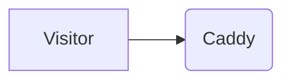

# snowy-burbot-homepage

Personal homepage for `snowy-burbot.com`, styled as a tiled Hyprland desktop. Static Astro build, served by unprivileged nginx in Docker behind Caddy and Cloudflare.

The layout lives in `src/components/`. All text lives in `src/content/`, so you can change content without touching the layout, by hand or from a script.

## Requirements

- Node.js 22 or later
- Docker, for the production image

## Run locally

```bash
npm install
npm run dev
```

Open `http://localhost:4321`. Draft writeups are visible in dev mode only.

## Edit content

| What | File | Window |
|---|---|---|
| Name, intro, fastfetch block, email, CV link, lab text and diagram, security.txt values | `src/content/site.yaml` | about, lab, contact |
| Hosts in the tailscale and lab windows | `src/content/hosts.yaml` | about, lab |
| Projects | `src/content/projects.yaml` | projects |
| Changelog | `src/content/changelog.yaml` | git log |
| Current work | `src/content/now.yaml` | now |
| Writeups | `src/content/writeups/*.md` | writeups, `/writeups`, RSS |

The build validates every file against the schemas in `src/content.config.ts`. If a field is missing or has the wrong type, `npm run build` fails and names the file and field, so a broken edit never reaches the live site.

**Note:** Quote dates in YAML (`since: "2026-11-09"`). Unquoted, YAML turns them into date objects and the build rejects them. The scripts below do this for you.

### Content scripts

Update the now window:

```bash
npm run now -- "Setting up fail2ban"
npm run now -- --add "Porting Bioma to Hyprland"
npm run now -- --done setting-up-fail2ban
npm run now -- --list
```

Add a changelog entry (current month by default):

```bash
npm run log -- "Moved Pocket ID to the NAS"
npm run log -- 2026-12 "Moved Pocket ID to the NAS"
npm run log -- next "Akashi replaces Caddy"
```

Both scripts keep the comments in the YAML files. They're plain Node scripts, so a Claude Code Routine, a cron job, or a CI step can call them, commit the change, and trigger a rebuild.

### Writeups

Create `src/content/writeups/SLUG.md`:

```markdown
---
title: One wildcard certificate instead of eleven
date: 2026-08-20
summary: One line for the list and the RSS feed.
tags: [pki, caddy]
draft: true
---

Text in Markdown.
```

Set `draft: false` to publish. The URL is `/writeups/SLUG`.

### Diagrams

Writeups can contain flowcharts and sequence diagrams in a fenced code block with the language `mermaid`:

````markdown

````

Diagrams render to SVG during the build, so visitors download no extra JavaScript, and they follow the theme toggle. An invalid diagram fails the build.

Rendering needs Chromium. Run this once on a new machine:

```bash
npx playwright install chromium
```

**Note:** Colors come from `.mermaid-fig` in `src/styles/global.css`. Mermaid `style` and `classDef` lines have no effect, and other diagram types need their own rules there. When you update `playwright` in `package.json`, change the image tag in `Dockerfile` and `.forgejo/workflows/build.yml` to match.

## Before going live

- In `site.yaml`, set `draftNote: ""`.
- Add `public/cv.pdf` and set `cv: /cv.pdf`. Until the file exists, keep `cv` empty, or fail2ban counts the 404s.
- Add Impressum and Datenschutz pages and set their paths under `legal`.
- Make sure `security@snowy-burbot.com` reaches a mailbox you read (Cloudflare Email Routing).

## Docker image

GitHub Actions builds the image on every push to `main` and publishes it to GitHub Container Registry (`.github/workflows/docker.yml`):

| Event | Tags |
|---|---|
| Push to `main` | `latest`, `sha-<short commit>` |
| Tag `v1.2.3` | `1.2.3`, `1.2` |
| Pull request | Build only, nothing is pushed |

Pull and run the published image:

```bash
docker pull ghcr.io/hainick/snowy-burbot-homepage:latest
docker run --rm -p 8080:8080 --read-only --tmpfs /tmp --cap-drop ALL ghcr.io/hainick/snowy-burbot-homepage:latest
```

Open `http://localhost:8080`. The container listens on port 8080 as a non-root user and answers `GET /healthz` with `ok`.

To build locally instead:

```bash
docker build -t snowy-burbot-homepage .
```

On the VPS, use `compose.example.yml` as a starting point. It pulls the published image and joins Seki's Docker network without publishing a port, so Caddy reaches it as `homepage:8080`. Check the network name with `docker network ls` first. To deploy a new version:

```bash
docker compose pull && docker compose up -d
```

To roll back, set `image:` to an older `sha-...` tag and run `docker compose up -d`.

## Security headers

`security-headers.conf` sets a strict Content-Security-Policy without `unsafe-inline`. That works because the build emits no inline scripts or styles (`astro.config.mjs` turns inlining off, and the theme snippet lives in `public/theme-init.js`). If you add an inline `<script>` or a `style=""` attribute, the browser blocks it. Put it in a file instead. For the same reason, code blocks use Prism rather than Astro's default, Shiki, which writes its colors as `style=""` attributes.

## Project layout

```
src/
  content/            all text (YAML and Markdown)
  content.config.ts   schemas for the content
  components/         Bar, Window, and one component per window
  layouts/Base.astro  page shell, fonts, theme
  lib/                content helpers, Mermaid CSP cleanup
  pages/              home, writeups, rss.xml, 404, security.txt, terminal.json
  scripts/desktop.ts  window focus, fullscreen, keyboard, clock, theme
  scripts/eggs.ts     easter eggs
  styles/global.css   Tokyo Night tokens and layout
scripts/              content scripts (now, log)
public/               favicon, robots.txt, theme-init.js
```
