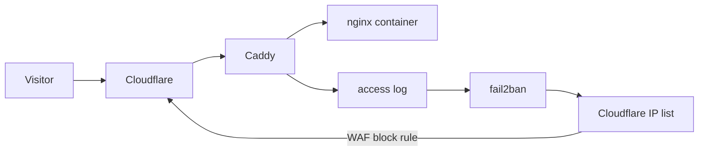

<!-- DRAFT: check every number against the logs before publishing. -->

This site is a folder of static HTML. It has no login, no database, no PHP, and no API. There's nothing on it to break. I still put fail2ban in front of it before it went live, because I wanted to see what shows up when a new domain starts answering on port 443.

Something showed up within minutes.

## The setup

Every request goes through Cloudflare first. Caddy on my server only accepts connections from Cloudflare's address ranges, takes the real client IP from the `CF-Connecting-IP` header, and writes a JSON access log for this site only. fail2ban reads that log. When a jail triggers, a small script puts the address on a Cloudflare IP list, and a WAF rule blocks that list for this hostname. The ban happens at Cloudflare's edge, so a banned host never reaches my server again.

Three jails watch the log:

| Jail | Triggers on | Threshold |
|---|---|---|
| `homepage-probe` | Paths no real visitor asks for: `/.env`, `/.git/`, `/wp-login.php`, `.php` | 1 hit |
| `homepage-404` | 403 and 404 responses | 20 in 10 minutes |
| `homepage-flood` | Any request | 1000 in 10 minutes |

Bans escalate per address: 1 day, then 30 days, then up to a year. IPv6 addresses are banned as the whole /64, because a single host usually controls one.

## Minute one: Cloudflare Workers

The first ban wasn't a classic scanner. It was an IPv6 address from Cloudflare's own Workers egress range. Two different things came from it: a request for `/wp-admin/install.php`, and Cloudflare's `AgentReadiness` checker looking for `/.well-known/mcp.json`, `openapi.json`, and sitemaps. Those 404s added up.

Someone is running a WordPress scanner on Workers, so their requests leave from the same shared addresses that Cloudflare uses for its own tools. I thought about unbanning it and decided not to. The ban only applies to my site, and nothing a real visitor needs comes from that range. It also showed me a gap: crawlers asked for a sitemap that didn't exist yet, so I added one.

## Overnight

<!-- TODO: fill in exact counts from fail2ban-client status and the Caddy log. -->

By the next morning, fail2ban had banned 13 addresses, and none of them were false positives. They fell into a few groups.

**A distributed WordPress scan.** Many different addresses, each asking for one or two WordPress paths like `/wp-login.php`, `/xmlrpc.php`, or `/wp-includes/wlwmanifest.xml`, then moving on. No single host sends enough to look like an attack. That's the point of spreading it out. The `homepage-probe` jail catches it anyway, because one request for a path that can't exist is enough.

**Secrets and source control leaks.** Requests for `/.env`, `/laravel/.env`, `/.git/config`, and `/.svn/wc.db`. These scanners look for sites that deployed their whole project folder, including credentials and repository history. One of them used a doubled slash (`//laravel/.env`), which my first filter missed. I fixed the regex the same day.

**A React2Shell probe.** One request was a `POST /` with a `Next-Action` header. That's the shape of an exploit attempt for CVE-2025-55182, the remote code execution bug in React Server Components that hit Next.js apps in late 2025. My site isn't Next.js, so the request did nothing, but it also didn't match any of my filters. I added a rule for `POST` requests and the `Next-Action` header, since a static site has no reason to accept either.

**A bot pretending to be Claude.** One client sent a `Claude-User` user agent from a budget VPS provider. Anthropic's real fetchers don't come from there. A trusted name in the user agent is cheap to copy, so the jails look at what a client asks for, not what it calls itself.

## What I changed afterwards

- Added a sitemap, because real crawlers asked for one and got 404s.
- Extended the probe filter: `.svn`, `.hg`, `.vscode`, `@vite`, `POST` requests, and the `Next-Action` header.
- Raised the maximum ban from a few months to a year.
- Kept the access log for 14 days, then it rotates away.

## What I took from it

A site doesn't have to be vulnerable to be scanned. The scanners don't know what's running until they ask, so they ask everything. Most of the traffic in the first day was automated probing, not people.

The cheapest signal turned out to be the most reliable one: a request for a path that can't exist on this site. One hit is enough to ban, and in the first day it never banned a real visitor.

The live numbers are in the threats window on the home page. It shows counts only, no addresses.
